# Data model

The Postgres schemas the app owns, as created by the Drizzle migrations in `db/migrations/`
(schema source: `db/schema/app.ts`, `db/schema/workday.ts`). dbt's `analytics*` schemas are
documented in the dbt project (BR-04 onward).

`tests/db/data-model-doc.test.ts` compares this file with `information_schema` after migrating:
every table and column in `app` and `workday` must have a row below, and every row below must
exist. Change the schema and this file in the same little rock.

## Schemas

| Schema | Owner | Purpose |
|---|---|---|
| `app` | the seat planner | The leaders' plan: org hierarchy, seats, audit log, approved headcount (D-008, D-010). |
| `workday` | ingest and seed scripts only | The mock HRIS. Read-only to the app (D-015). |
| `analytics` | dbt | Marts the dashboard reads. Created empty by the first migration. |
| `drizzle` | drizzle migrator | `__drizzle_migrations`: which migrations have run. Not app data. |

## Tables at a glance

| Table | One line |
|---|---|
| `app.divisions` | Top level of the org hierarchy. |
| `app.groups` | Middle level: a group belongs to one division. |
| `app.squads` | Bottom level: a squad belongs to one group and owns seats. |
| `app.leaders` | Engineering leaders who edit the plan, each scoped to one division or one group. |
| `app.seats` | One approved seat in a squad, filled or not; the row the board shows, with an optimistic-lock `version`. |
| `app.seat_changes` | Append-only audit log: one row per seat change; a move is two rows sharing `move_id`. |
| `app.headcount_plan` | Approved seat count per squad per quarter (the plan the HRIS is reconciled against). |
| `workday.workers` | Current typed view of Workday: one row per worker ever seen in an accepted report (upsert-only). |
| `workday.raw_worker_report` | Every row of every accepted Workday report, as text, exactly as the file had it. |
| `workday.ingest_runs` | One row per ingest attempt: loaded, skipped (same file hash) or rejected. |

## ER diagram

```mermaid
erDiagram
    divisions ||--o{ groups : contains
    groups ||--o{ squads : contains
    squads ||--o{ seats : owns
    squads ||--o{ headcount_plan : "planned per quarter"
    divisions |o--o{ leaders : "scope (division leader)"
    groups |o--o{ leaders : "scope (group leader)"
    seats ||--o{ seat_changes : "history of"
    leaders ||--o{ seat_changes : "acted"
    leaders |o--o{ seats : "last updated"
    seat_changes |o--o| seat_changes : "reverses"
    workers |o..o| seats : "worker_id (no FK)"
    workers |o..o| leaders : "worker_id (no FK)"
    ingest_runs ||..o{ raw_worker_report : "file_sha256 (no FK)"
    raw_worker_report }o..o{ workers : "worker_id (no FK)"

    divisions {
        int division_id PK
        text name UK
    }
    groups {
        int group_id PK
        int division_id FK
        text name UK
    }
    squads {
        int squad_id PK
        int group_id FK
        text name
    }
    leaders {
        int leader_id PK
        text worker_id UK
        text display_name
        text scope_type
        int division_id FK
        int group_id FK
    }
    seats {
        int seat_id PK
        int squad_id FK
        text seat_type
        text status
        text worker_id
        int version
        timestamptz updated_at
        int updated_by_leader_id FK
    }
    seat_changes {
        bigint change_id PK
        uuid move_id
        int seat_id FK
        text change_type
        text worker_id
        text from_status
        text to_status
        text from_worker_id
        text to_worker_id
        int actor_leader_id FK
        date effective_date
        timestamptz created_at
        bigint reverses_change_id FK
        text note
    }
    headcount_plan {
        int squad_id PK
        date quarter_start PK
        int approved_seats
    }
    workers {
        text worker_id PK
        text first_name
        text last_name
        text email
        text worker_type
        text status
        date hire_date
        date termination_date
        text manager_worker_id
        text job_title
        text supervisory_org
        text position_id
        text cost_center
        text location
        date as_of_report_date
        timestamptz updated_at
    }
    raw_worker_report {
        int raw_id PK
        date report_date
        text source_file
        text file_sha256
        int source_row
        timestamptz loaded_at
        text worker_id
        text worker_name
        text work_email
        text worker_type
        text worker_status
        text hire_date
        text termination_date
        text contract_end_date
        text manager_id
        text job_title
        text supervisory_organization
        text position_id
        text cost_center
        text location
    }
    ingest_runs {
        int run_id PK
        text source_file
        text file_sha256
        date report_date
        int row_count
        text status
        jsonb rejection_reasons
        timestamptz ran_at
    }
```

Dotted lines are logical links with no foreign key (see "Design choices").

## Tables

### `app.divisions`
Top level of the org hierarchy.

| Column | Type | Null | Notes |
|---|---|---|---|
| `division_id` | integer identity | no | PK |
| `name` | text | no | unique |

### `app.groups`
Middle level of the hierarchy; a group belongs to one division.

| Column | Type | Null | Notes |
|---|---|---|---|
| `group_id` | integer identity | no | PK |
| `division_id` | integer | no | FK → `app.divisions` |
| `name` | text | no | unique |

### `app.squads`
Bottom level of the hierarchy; seats belong to squads.

| Column | Type | Null | Notes |
|---|---|---|---|
| `squad_id` | integer identity | no | PK |
| `group_id` | integer | no | FK → `app.groups` |
| `name` | text | no | unique within its group |

### `app.leaders`
Engineering leaders who edit the plan. A division leader can edit every squad in the division; a
group leader only the group's squads.

| Column | Type | Null | Notes |
|---|---|---|---|
| `leader_id` | integer identity | no | PK |
| `worker_id` | text | no | unique; the leader's Workday worker id (no FK) |
| `display_name` | text | no | |
| `scope_type` | text | no | `division` \| `group` |
| `division_id` | integer | yes | FK → `app.divisions`; set only when `scope_type = 'division'` |
| `group_id` | integer | yes | FK → `app.groups`; set only when `scope_type = 'group'` |

### `app.seats`
One approved seat in a squad. Seats are never deleted; a vacated seat becomes `backfill`.

| Column | Type | Null | Notes |
|---|---|---|---|
| `seat_id` | integer identity | no | PK |
| `squad_id` | integer | no | FK → `app.squads` |
| `seat_type` | text | no | `employee` \| `contingent` |
| `status` | text | no | `filled` \| `open` \| `backfill` \| `offer_accepted` |
| `worker_id` | text | yes | set if and only if `status = 'filled'`; unique when not null (no double-seating); no FK |
| `version` | integer | no | default 0, never negative; +1 on every update (optimistic lock, D-011) |
| `updated_at` | timestamptz | no | default `now()` |
| `updated_by_leader_id` | integer | yes | FK → `app.leaders`; null for seeded rows |

No position column: seats match Workday by `worker_id` only (D-029).

### `app.seat_changes`
Append-only audit log (D-010). A move writes two rows (`move_out` on the source seat, `move_in` on
the target) sharing a `move_id`; undo inserts reversing rows. Rows are never updated or deleted.

| Column | Type | Null | Notes |
|---|---|---|---|
| `change_id` | bigint identity | no | PK |
| `move_id` | uuid | yes | shared by the two rows of a move; required for `move_out` / `move_in` |
| `seat_id` | integer | no | FK → `app.seats` |
| `change_type` | text | no | `move_out` \| `move_in` \| `fill` \| `vacate` \| `reserve` \| `release` \| `undo` \| `demo_touch` |
| `worker_id` | text | yes | the worker the change is about (mover, hire, leaver); no FK |
| `from_status` | text | no | seat status before (same values as `app.seats.status`) |
| `to_status` | text | no | seat status after |
| `from_worker_id` | text | yes | seat's worker before; set if and only if `from_status = 'filled'` |
| `to_worker_id` | text | yes | seat's worker after; set if and only if `to_status = 'filled'` |
| `actor_leader_id` | integer | no | FK → `app.leaders`; who made the change |
| `effective_date` | date | no | when the change takes effect (today to +90 days in the app, D-012) |
| `created_at` | timestamptz | no | default `now()`; when it was saved |
| `reverses_change_id` | bigint | yes | FK → `app.seat_changes`; set if and only if `change_type = 'undo'`; unique, so a change is reversed at most once |
| `note` | text | yes | free text |

Change types: `move_out` / `move_in` (the two halves of a move), `fill` (a worker takes an open,
backfill or reserved seat, e.g. a new hire), `vacate` (a worker leaves a seat, e.g. a termination),
`reserve` (an accepted offer holds a seat), `release` (a leader frees a terminated worker's seat,
BR-07), `undo` (a reversing row), `demo_touch` ("simulate another leader's edit", BR-02).

### `app.headcount_plan`
Approved seats per squad per quarter.

| Column | Type | Null | Notes |
|---|---|---|---|
| `squad_id` | integer | no | PK part; FK → `app.squads` |
| `quarter_start` | date | no | PK part; must be Jan 1, Apr 1, Jul 1 or Oct 1 |
| `approved_seats` | integer | no | never negative |

### `workday.workers`
The current, typed view of Workday: one row per worker ever seen in an accepted report. Written only
by `scripts/ingest/` and `scripts/seed/` (D-015).

**Upsert-only.** Each accepted report inserts new workers and updates the ones it lists; it never
deletes. A worker missing from a later report keeps their row with an older `as_of_report_date`,
which dbt treats as a reconciliation exception, not a deletion. Because rows persist, a worker
missing from a report can still hold a position that a listed worker now claims, so `position_id`
is deliberately **not unique** here. The partial unique index `workers_position_id_active_key`
(D-029) was dropped in migration `0004_worried_diamondback.sql` (LR-03-06, D-034): it made every
report after a backfill fail and be recorded `rejected`. "One current holder per position" is now
checked on the latest report only, by the dbt singular test
`analytics/tests/assert_one_current_holder_per_position.sql` (severity `error`). The ingest
validator still rejects a single file that lists a position twice among non-terminated rows.

| Column | Type | Null | Notes |
|---|---|---|---|
| `worker_id` | text | no | PK; Workday's `Worker_ID`: six digits for employees (`104217`), `C-` plus five digits for contingent workers (`C-04512`) (D-031) |
| `first_name` | text | no | |
| `last_name` | text | no | |
| `email` | text | no | |
| `worker_type` | text | no | `employee` \| `contingent` |
| `status` | text | no | `active` \| `leave` \| `terminated` |
| `hire_date` | date | no | |
| `termination_date` | date | yes | |
| `manager_worker_id` | text | yes | the manager's `worker_id`; no FK (a manager can be missing from an extract) |
| `job_title` | text | no | |
| `supervisory_org` | text | no | as in the report: `<org name> (<manager full name>)`; follows the manager tree, not squads (D-031) |
| `position_id` | text | no | Workday position (D-029); not unique (D-034: one current holder is a dbt test on the latest report); not linked to `app.seats` |
| `cost_center` | text | no | D-029 |
| `location` | text | no | D-029 |
| `as_of_report_date` | date | no | date of the report this row came from |
| `updated_at` | timestamptz | no | default `now()`; when this row was loaded |

### `workday.raw_worker_report`

Every row of every accepted report, exactly as the file had it (D-028): all text, nothing trimmed,
cast or renamed beyond the header becoming snake_case. A blank cell is an empty string, not null.
Kept for every report, so it is the history; `workday.workers` is the current view. Cleaning happens
in dbt staging. Written only by `scripts/ingest/`.

| Column                     | Type        | Null | Notes                                                           |
| -------------------------- | ----------- | ---- | --------------------------------------------------------------- |
| `raw_id`                   | integer     | no   | PK; identity                                                    |
| `report_date`              | date        | no   | taken from the file name (`worker_report_YYYY-MM-DD.csv`)       |
| `source_file`              | text        | no   | file name                                                       |
| `file_sha256`              | text        | no   | SHA-256 of the file's bytes; with `source_row` it is unique     |
| `source_row`               | integer     | no   | 1-based row number after the header                             |
| `loaded_at`                | timestamptz | no   | default `now()`                                                 |
| `worker_id`                | text        | no   | report column `Worker_ID`                                       |
| `worker_name`              | text        | no   | `Worker_Name`, `Last, First`                                    |
| `work_email`               | text        | no   | `Work_Email`                                                    |
| `worker_type`              | text        | no   | `Worker_Type` text (`Employee`, `Contingent Worker`)            |
| `worker_status`            | text        | no   | `Worker_Status` text (`Active`, `On Leave`, `Terminated`)       |
| `hire_date`                | text        | no   | `Hire_Date`, `MM/DD/YYYY`                                       |
| `termination_date`         | text        | no   | `Termination_Date`; empty string when blank                     |
| `contract_end_date`        | text        | no   | `Contract_End_Date`; empty string when blank                    |
| `manager_id`               | text        | no   | `Manager_ID`; empty string when blank                           |
| `job_title`                | text        | no   | `Job_Title`, possibly with stray whitespace                     |
| `supervisory_organization` | text        | no   | `Supervisory_Organization`                                      |
| `position_id`              | text        | no   | `Position_ID`                                                   |
| `cost_center`              | text        | no   | `Cost_Center`                                                   |
| `location`                 | text        | no   | `Location`, possibly with stray whitespace                      |

### `workday.ingest_runs`

One row per ingest attempt. A rejected run loads nothing and leaves the previous report current.

Rules:

- **Only a report newer than the latest loaded one is accepted** (approved by Rob, 2026-11-12). An older or same-dated file with
  a different hash is `rejected` ("not newer than the loaded report"). The same file twice is
  `skipped`. All ingests take one advisory lock, so concurrent files are checked one at a time.
- **Workers are upsert-only** (approved by Rob, 2026-11-12): see `workday.workers` above.
- **Exact header** (added in review). The header must hold exactly the 14 report columns: a
  missing, unknown or duplicate column rejects the file.
- **Required non-blank columns** (approved by Rob, 2026-11-12). `Worker_Name` (`Last, First`), `Work_Email`, `Job_Title`,
  `Supervisory_Organization`, `Position_ID`, `Cost_Center` and `Location` must be non-empty on every
  row, because the typed table needs them.
- **Unique positions** (added in review). `Position_ID` must be unique among non-`Terminated` rows
  within the file. Across reports it is a dbt check, not a database constraint (D-034).
- **Invalid UTF-8 rejects the file** (added in review), as does CSV syntax the parser can't read.
- **A load failure is a rejection too** (added in review). If the database refuses the load, the load rolls back and a `rejected` run is recorded with
  the database's message.
- Row numbers in messages count the first data row as row 1 (the header is "header").

| Column              | Type        | Null | Notes                                                              |
| ------------------- | ----------- | ---- | ------------------------------------------------------------------ |
| `run_id`            | integer     | no   | PK; identity                                                       |
| `source_file`       | text        | no   | file name                                                          |
| `file_sha256`       | text        | no   | SHA-256 of the file's bytes                                        |
| `report_date`       | date        | yes  | from the file name; null if the name has no date (rejected)        |
| `row_count`         | integer     | no   | data rows in the file (0 if the file couldn't be parsed)           |
| `status`            | text        | no   | `loaded` \| `skipped` \| `rejected`                                |
| `rejection_reasons` | jsonb       | no   | JSON array of messages naming row and column; `[]` unless rejected |
| `ran_at`            | timestamptz | no   | default `now()`                                                    |

## Design choices

- **Enums are `text` + `CHECK`**, not Postgres enum types (`db/schema/checks.ts`). A bad value is a
  `check_violation` (SQLSTATE `23514`) naming the constraint; adding a value is a one-line
  constraint swap in a migration; and dbt reads plain text, so `accepted_values` tests mirror the
  same lists.
- **Integer identity keys** (`GENERATED ALWAYS AS IDENTITY`) on `app` tables. Worker ids are text
  because they come from Workday.
- **No foreign keys from `app` to `workday`.** `app.seats.worker_id`, `app.seat_changes.*worker_id`
  and `app.leaders.worker_id` are plain text. Ingest (BR-03) upserts `workday` rows from each full
  report (never deletes), a worker can vanish from a report or be terminated while still seated, and those are
  reconciliation exceptions for dbt to flag. An FK would make ingest fail (or cascade into the
  plan) instead, and would couple two systems that are separate in production (D-008).
- **Leader scope as two FK columns.** The spec's polymorphic `scope_id` can't carry a foreign key,
  so a leader has `division_id` or `group_id`, and a `CHECK` makes exactly the one matching
  `scope_type` non-null.
- **`workday.workers` doesn't second-guess the HRIS.** Beyond types and enums,
  it accepts what the report says; dbt reports oddities instead of the loader rejecting them.
- **Append-only audit log.** A custom migration (`db/migrations/0002_seat_changes_append_only.sql`)
  adds a `BEFORE UPDATE OR DELETE ... FOR EACH ROW` trigger that always raises, and a
  `BEFORE TRUNCATE ... FOR EACH STATEMENT` trigger that raises unless the transaction has run
  `SET LOCAL app.allow_seat_changes_reset = 'on'`.
  **How the seed resets the table (LR-01-07):** in one transaction, `SET LOCAL
  app.allow_seat_changes_reset = 'on'`, then `TRUNCATE` the `app` and `workday` tables
  (`RESTART IDENTITY`), then insert. `SET LOCAL` ends with the transaction, so nothing else ever
  runs with the escape hatch on. The triggers stop accidents; BR-07's grants are the access control.
- **Schemas come from migrations.** `0000_create_schemas.sql` (custom) runs
  `CREATE SCHEMA IF NOT EXISTS` for `app`, `workday` and `analytics`, so a new Neon database needs
  no setup and the local Docker volume (whose init script already made them) is unaffected. Its
  drizzle-kit snapshot records `app` and `workday`, so the generated `0001_initial_tables.sql`
  doesn't try to create them again.
- **Migration runner.** `pnpm db:migrate` runs `scripts/db/migrate.ts`, which applies pending
  migrations with `drizzle-orm/node-postgres/migrator` using `DATABASE_URL_UNPOOLED`, falling back
  to `DATABASE_URL` (D-007). It prints only counts and error codes, never the connection string.
  `pnpm test:db` runs the same function first (Vitest `globalSetup`).

## Analytics marts (dbt, LR-03-03)

Built by dbt in `analytics/` into the `analytics` schema (intermediate models in
`analytics_intermediate`). Not covered by the `information_schema` doc test above, which checks only
`app` and `workday`. Column-level descriptions live in `analytics/models/marts/_marts.yml`.

| Model | Grain | One line |
|---|---|---|
| `analytics.dim_squads` | `squad_id` | Squad with its group and division. |
| `analytics.dim_people` | `worker_id` | Each worker's row from the latest report they appear in, plus the seat they hold now. |
| `analytics.rpt_squad_headcount` | `squad_id` x `report_date` | Seats by state, the approved plan for the quarter, variance and fill rate. |

Definitions in `rpt_squad_headcount`:

- Committed seats = filled employee + filled contingent + `offer_accepted` seats.
- **Variance** = committed seats minus approved seats. Positive is over plan (the `squad_not_over_plan`
  test fails), zero is on plan, negative is room under plan.
- **Fill rate** = filled seats (employee + contingent) divided by approved seats, a fraction rounded
  to 4 decimals; null when approved seats is zero.
- The plan is the squad's `app.headcount_plan` row for the quarter containing the report date.
- Seat counts are as of each report date (D-036). `int_seat_state_as_of` (one row per seat per report
  date) starts from live `app.seats` and rewinds every `app.seat_changes` row whose `effective_date`
  is after the report date, using its `from_*` columns, in `(effective_date, change_id)` order.
  `int_squad_seat_counts` counts those states per squad and report date. A move effective after a
  report date is therefore not in that date's row. `is_latest_report` only marks the newest report.
- `dim_people` starts from reports: a worker who holds a seat but appears in no report is absent.

Intermediate models: `int_worker_latest_report` (one row per worker), `int_seat_state_as_of`,
`int_squad_seat_counts`, and `int_seat_occupancy` (who held which seat when, half-open periods,
ordered by `(effective_date, change_id)`; D-037 makes that agree with save order).

Custom tests (`analytics/tests/`): `no_double_seating` (error; no worker holds two seats in
overlapping periods, built from `app.seat_changes` in `int_seat_occupancy`), `squad_not_over_plan`
(error), `assert_squad_headcount_matches_live_seats` (latest-report counts equal live `app.seats`
when no change is effective after the latest report; squads with no seats count as 0), and
`assert_seat_changes_effective_dates_in_save_order` (warn; backstop for the move service's
effective-date rule, D-037). dbt unit tests in `analytics/models/intermediate/_unit_tests.yml` cover
the seat-state and occupancy models and the missing-worker case with hand-made rows, because the
seed has no `seat_changes`.
